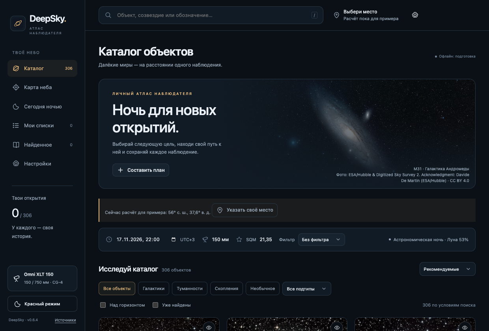
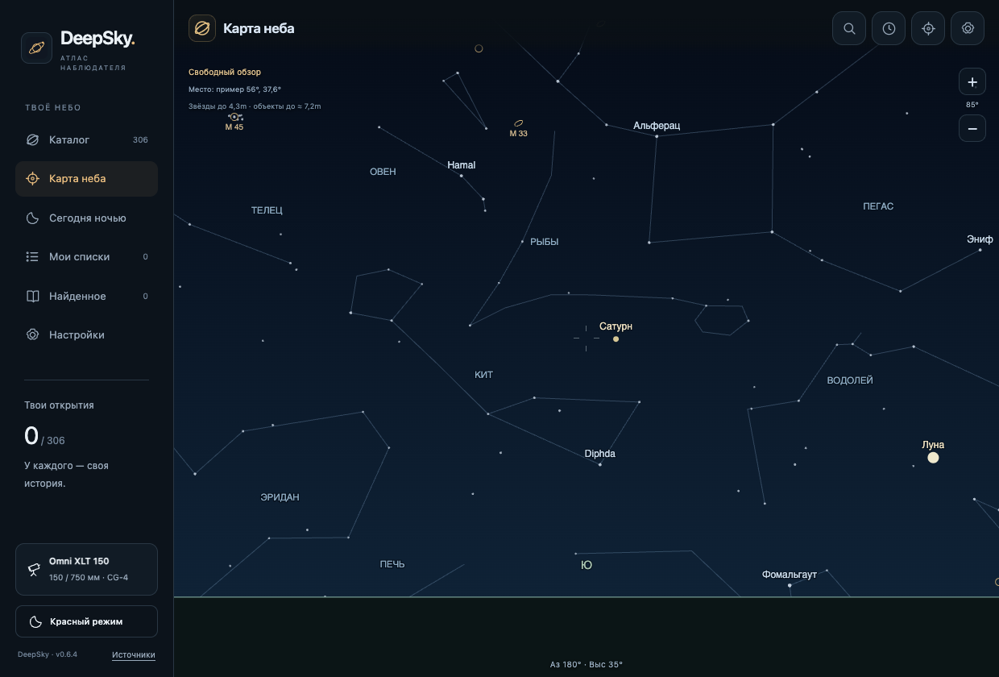

# DeepSky

Полевой атлас для любительских наблюдений в телескоп. В каталоге 306 целей, от галактик и туманностей до двойных звёзд и квазара 3C 273. Поиск, карта, списки и журнал работают на устройстве. Для Android есть отдельный режим наведения с камерой.



## Перед выходом под небо

1. В настройках укажи место, апертуру, окуляр и яркость фона неба по SQM.
2. Открой «Сегодня ночью» и выбери время. Планировщик учитывает высоту целей, сумерки, Луну и выбранный фильтр.
3. В карточке цели открой «Путь к объекту». Обзор показывает созвездия, следующие масштабы помогают перейти к искателю и окуляру.
4. Добавь цель в список или отметь её найденной. Впечатления можно записать сразу или позже.



Карта использует HYG и дополнительные звёздные поля Gaia DR3 вокруг целей каталога. На Android можно включить ориентацию по датчикам, наложить линии созвездий на камеру и уточнить направление по знакомой звезде. Оценка сложности приблизительная. Прозрачность, засветка и опыт наблюдателя влияют на то, какие детали будут видны.

## Запуск

Веб-версия готова к запуску из корня репозитория.

```sh
python3 -m http.server 4173 --bind 127.0.0.1 --directory dist
```

Открой `http://127.0.0.1:4173/`. Для сборки Android, запуска проверок и подписи APK см. [инструкцию для Android](ANDROID.md).

## Данные и приватность

Каталог и карта входят в сборку. Журнал, списки и настройки сохраняются локально. Чтобы перенести их между устройствами, в настройках экспортируй JSON. Копия содержит записи и координаты площадки в открытом виде. При импорте приложение запрашивает подтверждение замены текущих данных.

По желанию можно включить прогноз Open-Meteo. Для этого запроса координаты округляются до сотых долей градуса. На Android можно дополнительно включить фоновые проверки и уведомления о ясном ночном окне. Для режима с камерой используются Android CameraX и, на совместимых устройствах, сервисы Google Play для AR. Приложение рисует оверлей на устройстве.

## Исходники и материалы

- `dist/` — веб-приложение, астрономические данные, изображения и офлайн-кэш.
- `android/app/src/main/` — Android-интеграция, датчики, камера и погодные уведомления.
- `scripts/` — подготовка каталогов, проверка данных и сборка.
- [Источники каталога](dist/data/sources.json), [линии созвездий](dist/data/CONSTELLATIONS-LICENSE.txt), [авторы астрофотографий](dist/assets/image-credits.json), [источники обзорных снимков](dist/assets/preview-credits.json).

Обзорные JPEG получены из Digitized Sky Survey через NASA SkyView. Цифровые материалы DSS подготовил Space Telescope Science Institute по фотопластинкам Паломарской обсерватории и UK Schmidt Telescope. Для снимков действуют условия владельцев, в том числе ограничения на коммерческое использование. [Условия и атрибуция DSS](https://archive.stsci.edu/publishing/data-use)

Сведения об OpenNGC, HYG, Gaia, Astronomy Engine и Capacitor приложены рядом с данными и библиотеками. У сторонних материалов свои условия использования. Лицензию на распространение собственного кода выбирает автор.
